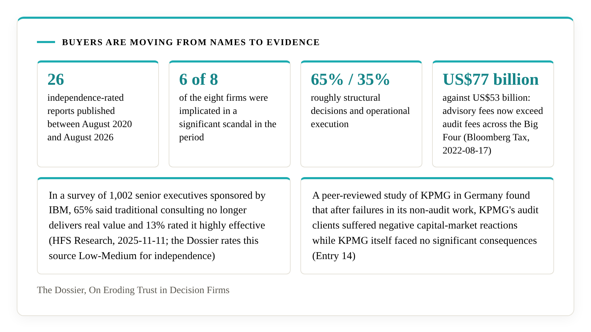

# Literacity

> What must a decision-maker get right, structurally, to avoid failure under uncertainty?

Every proposal you are asked to approve is a decision, written down, and the plan inside it is a structure that commits you to a course. That structure has six capabilities or lacks some of them: it tells what is really working, rules out the irreversible action, keeps looking for something better, commits once the evidence has settled, treats its hard limits as walls, and lets go of what the world has changed. Mathematics has proved that each of the six is necessary. A plan that lacks one will fail. The proof defines that failure exactly: loss that grows in proportion to time, however well everything else is run. Lean 4 checks the proof, and anyone can rebuild it.

Literacity is a team, and its work rests on one body of research from start to finish: Ismail's, the mathematician who proved the primitives. It shows you, with evidence you can check, whether a proposal, an adviser or your own organisation has the six.

## Buyers are moving from names to evidence

Most advice is bought on weak signals: a brand, an experienced-sounding pitch, a case study from someone else's company. The public record on those signals has been moving. The [Dossier](https://decisional-integrity.github.io/Field/dossier/), *On Eroding Trust in Decision Firms*, compiles 26 independence-rated reports published between August 2020 and August 2026: 14 on eight major consulting and audit firms and 12 on the industry, academic assessments and counter-narratives. It reports that:

- six of the eight firms were implicated in a significant scandal in the period;
- advisory fees now exceed audit fees across the Big Four, US$77 billion against US$53 billion (Bloomberg Tax, 2022-08-17);
- in a survey of 1,002 senior executives sponsored by IBM, 65% said traditional consulting no longer delivers real value and 13% rated it highly effective (HFS Research, 2025-11-11; the Dossier rates this source Low-Medium for independence);
- a peer-reviewed study of KPMG in Germany found that after failures in its non-audit work, KPMG's audit clients suffered negative capital-market reactions while KPMG itself faced no significant consequences (Entry 14).

The Dossier classifies the failures it documents at roughly 65% structural decisions and 35% operational execution. If the advice you buy comes from a process that cannot show how it works, what is the chance it reaches the cause of your problem? The Dossier finds the cause mostly structural, and the structure is what the six primitives describe. An audit shows where your own structure stands against the six.

## What a missing primitive costs

Failure has one shape. Without the matching primitive, loss grows in proportion to time. If the best available option pays 100 each period and a structure captures 90, the gap is 10 every period: 10 after one, 100 after ten, 1,000 after a hundred. It does not average out. It can also hide: a process that lacks a required capability can post steady, positive results for a long time while the gap grows underneath.

The only way to avoid that loss is to possess the primitive. No amount of effort elsewhere makes up for a missing one, and none of the six can stand in for another: the paper proves that for all thirty ordered pairs. Possession is necessary. It is where every sound decision starts. [Why the primitives matter](docs/why-it-matters.md) explains it step by step.

## Every business is in Class C

The theory applies wherever at least one of six situations arises, and every business decision area meets at least one, because of what business is: information is incomplete, commitments are often irreversible, options can be comfortable without being best, some limits cannot be traded, and markets change. Any one is enough. The [self-check](docs/self-check.md) shows you each situation in your own decisions in minutes.

## The answer

[Ismail's Primitives](https://doi.org/10.5281/zenodo.23080967) identifies the six: Objective Tracking, Cross-Context Safety Transfer, Global Attractor Exploration, Policy Simplification, Feasibility Projection and Feedback Adaptation. Lean 4 machine-checks the proofs, which run to 12,667 lines in seven files with zero `sorry`, zero custom `axiom` and zero `opaque` definitions as of 2026-10-24, and anyone can rebuild them from the [Lean repository](https://github.com/M-Ismail-ZA/IsmailsPrimitives). The [field of Decisional Integrity](https://decisional-integrity.github.io/Field/) turns the result into [open criteria](https://decisional-integrity.github.io/Field/standard/standard/) that say what a decision structure must show to possess each primitive.

Two kinds of evidence point at the same question. The proof tells you what any decision structure needs. The Dossier shows what the lack looks like in the public record. Neither depends on trusting Ismail or Literacity.

## Why Literacity

Literacity is a team whose work rests on one body of research, Ismail's, from start to finish. The team carries out every audit, and Ismail, who founded and leads Literacity and trains the team in the research, is the final arbiter of every verification. As of 2026-10-22 it is the only firm that applies them: Ismail checked, and a public search on the same date found none. Advising on decision structures against the proof takes a combination of disciplines that the field calls uncommon, and each is claimed only where a public artefact shows it. Behind the work is a business guide written by Ismail with a method set for each primitive. [Why Literacity](docs/why-literacity.md) shows what one primitive, X2, looks like inside that guide, and what it takes to compete.

## Who stands behind it

Muhammed Ismail discovered and proved Ismail's Primitives. His authorship and priority rest on public artefacts: the DOI-registered paper, the Lean repository and its dated history, and the field's [author page](https://decisional-integrity.github.io/Field/about/author/). He is the director and owner of Literacity Pty Ltd, founded in 2016, and he is the final arbiter of its verifications. The approver role is held on proof, and Ismail's own approval is held to the same rule, with its artefacts public. The field's [competence page](https://decisional-integrity.github.io/Field/field/competence/) states how another person can step into it, by presenting artefacts of a stated type and depth, and it is open to anyone who can. See [About Muhammed Ismail](docs/about/muhammed-ismail.md) and [Literacity and Ismail](docs/about/relationship-to-ismail.md).

## What Literacity offers

You find out where your decision structure stands. An audit examines it against the open criteria and gives you a finding for each of the six primitives. Each finding cites the public criterion it rests on, and findings are private to you. The audit looks at how decisions are made, so it proceeds without access to what the decisions were about.

Where the audit finds a gap, build support closes it. You choose the tools, and a spreadsheet and a customer-relationship system can both qualify. What counts is that the tool performs the function and produces the outcome the criteria describe.

When a structure passes, you receive a dated verification statement that names your organisation, what was checked and the version of the criteria. It is valid for twelve months and is listed in the [registry](docs/certification/registry.md), where anyone can confirm it.

Training teaches your people the open criteria and the logic of the mathematics, so that they can evaluate their own systems. It comes as an executive briefing, as team training on your own decision records, and as assessor preparation.

A verdict applies at a date. When the verified structure changes materially, a fresh check follows.

When the work is done, [What's in it for you](docs/whats-in-it-for-you.md) sets out what you can say with the result and what stands behind each line.

Scope is agreed for each engagement after a discovery call.

## Test any proposal or adviser today

You can put a test to a proposal, or to an adviser, Literacity included, before any engagement. Ask for the mechanism: for a capability that matters to your decision, which specific mechanism in the adviser's own process performs it. Ask for a dated record: one case, with client details removed, where that mechanism changed a decision. Ask who else can read the record. A name, a client list and years of experience show what an adviser has been through. A credential shows what someone was trained in, and a referral shows that someone is willing to vouch. A mechanism and a dated record show what the process does. Put six questions to any proposal in front of you, and to the people who wrote it.

[Choosing an adviser, and checking a proposal](docs/choosing-an-adviser.md) gives the questions, and the test for whether a case study applies to you. The [show-your-work self-check](docs/self-check.md) puts the same questions to your own organisation.

## Every claim traces to the axioms

Every Literacity finding names the public criterion it rests on. Each criterion names its Lean definitions and rests on a numbered result in the paper. Each result is a named theorem in the Lean repository, with a file and a line, and Lean's kernel checks it from Mathlib's axioms. [The Trace](docs/the-trace.md) gives the five steps and the address of every necessity theorem.

## How the work can be checked

> Lean verifies Ismail. Ismail verifies the application. The client verifies that those two say the same thing.

The [paper](https://doi.org/10.5281/zenodo.23080967), the [Lean proof](https://github.com/M-Ismail-ZA/IsmailsPrimitives), the field and its criteria are open. The field's [audit it yourself](https://decisional-integrity.github.io/Field/field/audit-it-yourself/) page shows where to read the statements and definitions that Lean checked.

## The verification statement

The template reads as follows, with the bracketed fields filled in for each organisation verified.

> Ismail and Literacity verified that [Company] was evaluated on [date] and found to possess Ismail's Primitives in its decision structure. Evaluated against criteria version [x] on a sample of [y]. Valid for twelve months from [date].

The paper is licensed CC BY 4.0, so anyone may cite Ismail's Primitives. The statement is a public record that the author checked the application. If an organisation says it uses Ismail's Primitives, the registry shows whether a verification exists, and Ismail can confirm or deny on enquiry. The [certification terms](docs/certification/terms.md) set out what a verification asserts and records.

## Where things stand

The paper, the proof, the field, the standard and the Dossier are published. The first cohort of verifications will be published by Q2 2027, and the registry lists each one as it is issued.

## In this repository

| Page | What it gives you |
|---|---|
| [Why the primitives matter](docs/why-it-matters.md) | What a missing primitive costs, in plain words and arithmetic |
| [The Trace](docs/the-trace.md) | How every finding follows the field and the mathematics down to the axioms |
| [Why Literacity](docs/why-literacity.md) | What it takes to advise on this, and what you get |
| [What's in it for you](docs/whats-in-it-for-you.md) | What a verified organisation can say, and what stands behind each claim |
| [How it works](docs/how-it-works.md) | The seven steps of an engagement, from discovery to re-verification |
| [Choosing an adviser, and checking a proposal](docs/choosing-an-adviser.md) | Six questions for any adviser or proposal, and the case-study test |
| [Show-your-work self-check](docs/self-check.md) | The same questions for your own organisation |
| [Training](docs/training.md) | Executive briefing, team training and assessor preparation |
| [The Literacity charter](docs/about/charter.md) | The argument in long form, from the Dossier to the proof |
| [Frequently asked questions](docs/about/faqs.md) | Answers on scope, checking, confidentiality and timing |
| [About Muhammed Ismail](docs/about/muhammed-ismail.md) | His work, repositories, papers and skills |
| [Literacity and Ismail](docs/about/relationship-to-ismail.md) | Who is behind the work and how the three public accounts relate |
| [Certification terms](docs/certification/terms.md) | What a verification asserts and records |
| [Registry](docs/certification/registry.md) | Every verification issued |
| [Review discipline](docs/tools/review-discipline.md) | How this repository checks its own writing |

## Licence and citation

The paper is licensed CC BY 4.0 and the Lean code MIT. Cite Ismail's Primitives by its DOI, [10.5281/zenodo.23080967](https://doi.org/10.5281/zenodo.23080967). Citation details for this repository are in `CITATION.cff`.

## Contact

Write to [literacity@outlook.com](mailto:literacity@outlook.com) or through the [Literacity page on LinkedIn](https://www.linkedin.com/company/literacity-research/). An engagement begins with a discovery call.
