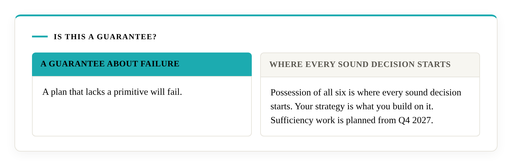

# Frequently asked questions

## Who is this for?

Literacity works with the people who sign off decisions: chief executives, owners, board members and heads of function, in organisations of any size. It also serves anyone about to hire an adviser who wants a way to examine the adviser's process before the engagement, and advisers who want a dated public record of how they decide.

## What do I receive?

An audit gives you a finding for each of the six primitives, each citing the public criterion it rests on, private to you. Where there are gaps, build support installs the mechanism with the tools you choose. On a pass you receive a dated verification statement, valid for twelve months and listed in the [registry](../certification/registry.md). Training prepares your people to evaluate their own systems against the open criteria. The [how-it-works](../how-it-works.md) page sets out the path.

## Why does Literacity exist?

The [Dossier](https://decisional-integrity.github.io/Field/dossier/) compiles 26 independence-rated reports on eight major consulting and audit firms and the industry, finds six of the eight implicated in a significant scandal between 2020 and 2026, and classifies the failures at roughly 65% structural and 35% operational. When the cause is structural, the useful question becomes what a decision structure must contain. Ismail's Primitives answers that with a proof, and Literacity audits and verifies against the criteria the field derived from it. The [charter](charter.md) tells the story in full.

## Is this a guarantee?

It is a guarantee about failure. A plan that lacks a primitive will fail. Possession of all six is where every sound decision starts, and your strategy is what you build on it. Sufficiency work is planned from Q4 2027.

## What does "fail" mean here?

In the proof, failure means linear regret: the gap between what a structure achieves and the best available grows in proportion to time, without limit. It describes the structure's long-run course against what was available to it. A plan is a structure that commits you to a course, and a plan that lacks a primitive ends in linear regret. An audit shows which primitives a plan has, by reading its records against the public criteria.

## Why can't a good consultant just do this?

A good consultant can read everything Literacity publishes. Assessing a real structure against the proofs takes a combination of disciplines, from formal verification in Lean 4 to information theory to knowledge of the setting assessed, which the field's [competence page](https://decisional-integrity.github.io/Field/field/competence/) calls uncommon. Each is claimed only where a public artefact shows it. Familiar methods supply part of the six and none supplies all six on its own. Every Literacity audit is carried out by the team at Literacity, which works from the author's research, and approved by the mathematician who proved the primitives as final arbiter, and as of 2026-10-22 no other firm applies them.

## How do I know a case study applies to me?

It applies when your situation matches it on six points: objective, risks, exploration, policies, constraints and the way beliefs had to be updated. [Choosing an adviser, and checking a proposal](../choosing-an-adviser.md) sets out the test.

## What is in Literacity's guide?

Literacity works from a business guide written by Ismail, with a part for each primitive and a method set at the end of each part. The [Why Literacity](../why-literacity.md) page shows one part in outline: X2 resolves into seven distinct methods, each tied to a named result in the proof. The guide is private to Literacity and its clients. A verdict rests on the public criteria, so you can check any finding without it.

## How do I tell an adviser who shows their work from one who relies on reputation?

Ask for the mechanism and a dated record for each of six capabilities, with client details removed. A name and years of experience show what an adviser has been through, and a mechanism with a dated record shows what its process does. [Choosing an adviser](../choosing-an-adviser.md) gives the six questions.

## Does this apply to my organisation?

Yes. The theory applies to environments in Class C, which show at least one of six situations, and every business decision area does, because information is incomplete, commitments are often irreversible, options can be comfortable without being best, some limits cannot be traded and markets change. One situation is enough, and the [self-check](../self-check.md) asks the six questions so that you can see each one in your own decisions. The field's [Class C page](https://decisional-integrity.github.io/Field/field/class-c/) defines the class.

## What does a verification say?

A verification records, for a named organisation at a stated date, that a mechanism performing each of the six functions exists and operates. It describes the structure as it stands at that date and is a conformance finding on necessity. The field's page on [necessity and sufficiency](https://decisional-integrity.github.io/Field/field/necessity-and-sufficiency/) explains why necessity is the floor under every sound decision. The [certification terms](../certification/terms.md) set out what a verification asserts and records.

## What can I say once I am verified?

You can quote the statement as written, and you can say what the evidence behind it supports: that your decision structure has the six capabilities the proof shows every sound structure needs, that the verification is dated and listed in the registry, and that anyone can check the mathematics. [What's in it for you](../whats-in-it-for-you.md) sets out ten lines you can use and what stands behind each.

## Who checks Literacity's work?

The yardstick is public, so any client can compare a finding with the published criteria and the criteria with the mathematics. The field describes three links: Lean verifies Ismail, Ismail verifies the application, and the client verifies that the two say the same thing. A qualified evaluator who is not the approver can examine an engagement afterwards, and a client can commission one. The separation between the research, the field and the commercial service is explained on the [Literacity and Ismail](relationship-to-ismail.md) page.

## What has been verified so far?

The paper, the Lean proof, the field, the standard and the Dossier are published and open to checking now. The first cohort of verifications will be published by Q2 2027, and the [registry](../certification/registry.md) will list each as it is issued. Each statement names what was checked, so you can apply the case-study test from [Choosing an adviser, and checking a proposal](../choosing-an-adviser.md) to any verification before relying on it. Case studies will show how each application was carried out.

## This reads like common sense. Why does it need theorems?

Common sense says to guard against risk. The theorems say what a structure must contain for loss not to grow in proportion to time. Common sense also accepts an artefact for a mechanism. A risk department, a register or a review calendar can exist without any decision having followed it. The field's [error theory](https://decisional-integrity.github.io/Field/field/error-theory/) page names this as mechanism misidentification. The test is the function: whether the tool changes decisions, is revised when circumstances change, and operates wherever the situation arises.

## Which decisions does the framework apply to?

All of them. The framework addresses the structure that produces decisions, in any domain, and an audit shows whether the process around a decision has the mechanisms the proof requires.

## What happens to our information?

Literacity analyses how decisions are made, so an audit proceeds without needing what the decisions were about. Confidentiality, access and disclosure terms are agreed with each client as part of the engagement. Case materials stay private. Only the fact and date of a pass are listed in the registry.

## What if a first audit finds a failure?

The client is told which primitives came up short and is given guidance on closing the gap. A failed audit stays private. The client can resubmit within six weeks. The [certification terms](../certification/terms.md) set out the details.

## Can we do this ourselves?

You can read all of it. Applying it to a real structure takes the competence on the field's [competence page](https://decisional-integrity.github.io/Field/field/competence/), a combination the field calls uncommon, and every part of it can be learned. A team can build it, and training is how Literacity helps. Literacity is a team that works from the author's research, with a guidebook of its own.

## Can I trace a Literacity finding to the axioms?

Yes. Each finding names the public criterion it rests on. The criterion names its Lean definitions, the paper numbers the result, the Lean repository holds the theorem at a stated file and line, and Lean's kernel checks it from Mathlib's axioms. [The Trace](../the-trace.md) gives the five steps and the address of every necessity theorem.

## Can other companies use Ismail's Primitives?

Yes. The paper is CC BY 4.0 and the Lean code is MIT, so any company may use the work with attribution to Ismail as the author. A verification statement records that Ismail checked a given application, and the registry shows which organisations hold one. Literacity's audit and verification are the route by which other companies' applications are approved. Ismail is the approver at present, and another person can take the role by showing the proof the competence page describes. See [Why Literacity](../why-literacity.md).

## What does training cover?

Training teaches the open criteria and the logic of the mathematics, so that people can evaluate their own systems through the lens of Ismail's Primitives. See [training](../training.md).

## What about sufficiency?

Sufficiency engagements are planned from Q4 2027. They build on Part III of the paper, a formally-verified bridge towards sufficiency, with the hypotheses fixed for each organisation's own definition of success.

## How does an engagement begin?

With a discovery call. Scope is agreed for each engagement after it, because a small business and a large corporation differ in the processes in scope, the evidence available and the terms that apply. Write to [literacity@outlook.com](mailto:literacity@outlook.com) or through the [Literacity page on LinkedIn](https://www.linkedin.com/company/literacity-research/).
