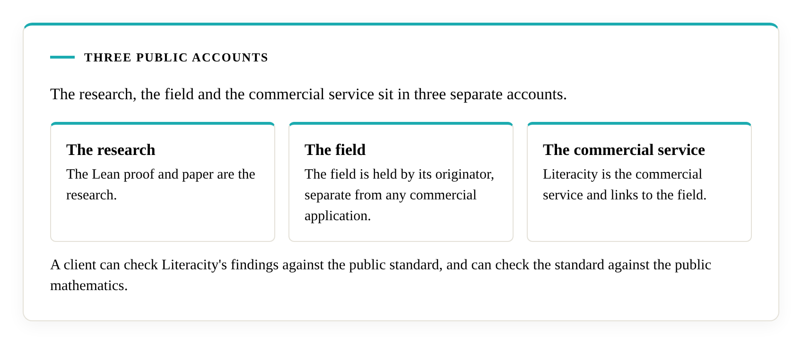
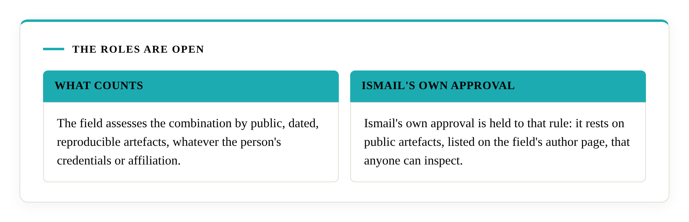

# Literacity and Ismail

Muhammed Ismail discovered and proved Ismail's Primitives. He is the director and owner of Literacity Pty Ltd, a company registered in South Africa in 2016 (registration number 2016/135857/07), and he is the final arbiter of Literacity's applications of the primitives. His authorship and priority rest on public artefacts a reader can check: the DOI-registered paper, the Lean repository and the field's [author page](https://decisional-integrity.github.io/Field/about/author/), which holds the full account.

## Three public accounts

The research, the field and the commercial service sit in three separate accounts. The [Lean proof and paper](https://github.com/M-Ismail-ZA/IsmailsPrimitives) are the research. The [field](https://decisional-integrity.github.io/Field/) is held by its originator, separate from any commercial application. Literacity is the commercial service and links to the field.

The separation exists so that Literacity's work can be checked. A client can check Literacity's findings against the public standard, and can check the standard against the public mathematics. The commercial work may involve confidential or privileged information. Keeping it apart from the field lets that work be checked against open material without disclosing Literacity's private methods, and the rigour requirements stay in public view.

## The primitives belong to everyone

The paper, the proof, the field and the criteria are open, and any company can build a service from them. The team at Literacity carries out every audit from the mathematician's research, and he is the final arbiter of every verification. The field's [competence page](https://decisional-integrity.github.io/Field/field/competence/) says how another person can take on the approving role, by presenting artefacts of a stated type and depth, and the role is open to anyone who can. As of 2026-10-22 no one else has presented that proof, and Ismail's own approval is held to the same rule, with its artefacts public. [Why Literacity](../why-literacity.md) sets out what the work involves, and [About Muhammed Ismail](muhammed-ismail.md) sets out his work, repositories and papers.

## Why the record is public

A name tells a buyer about an adviser's history. The [Dossier](https://decisional-integrity.github.io/Field/dossier/) cites a peer-reviewed study of KPMG in Germany (Entry 14). After failures in KPMG's non-audit work, its audit clients suffered negative capital-market reactions and KPMG itself faced no significant consequences. A verification statement carries different information: the date, what was checked and the version of the criteria. Anyone can compare it with the registry.

## What the verification statement adds

Anyone may cite Ismail's Primitives under the CC BY 4.0 licence. A verification statement is a public record that Ismail checked the application for a named organisation. Where no statement exists, the [registry](../certification/registry.md) shows no verification, and Ismail can confirm or deny on enquiry.

The path of an engagement is on the [how-it-works](../how-it-works.md) page.
