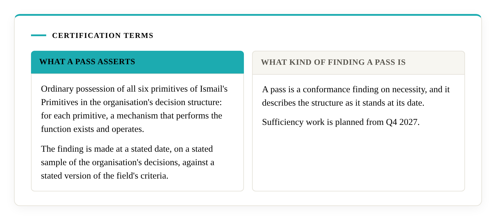
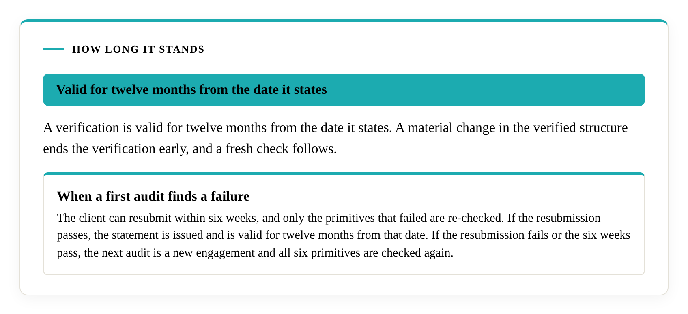

# Certification terms

A Literacity verification is a dated statement of fact. This page sets out what it asserts, what it records, how long it stands and what happens when a first audit finds a failure. The statement is called Primitive Necessity Verified. A company can cite it and anyone can check it.

## What a pass asserts

A pass records ordinary possession of all six primitives of [Ismail's Primitives](https://doi.org/10.5281/zenodo.23080967) in the organisation's decision structure: for each primitive, a mechanism that performs the function exists and operates. The finding is made at a stated date, on a stated sample of the organisation's decisions, against a stated version of the field's [criteria](https://decisional-integrity.github.io/Field/standard/standard/).

## What kind of finding a pass is

A pass is a conformance finding on necessity, and it describes the structure as it stands at its date. Sufficiency work is planned from Q4 2027.

## What the statement records

Each statement records the date, the company name, a brief disclosure of what was checked, the version of the criteria and the sampling rule. The material checked is drawn from the organisation's decision records: past decisions with the evidence behind them, the framework it currently uses, the decision process in effect, and its templates and procedures for new decisions. For an adviser, past proposals to its own customers are part of that record. The sample is chosen by a rule fixed before the evidence is read and includes one case that succeeded, one that failed and one still in progress.

The template reads as follows, with the bracketed fields filled in for each organisation verified.

> Ismail and Literacity verified that [Company] was evaluated on [date] and found to possess Ismail's Primitives in its decision structure. Evaluated against criteria version [x] on a sample of [y]. Valid for twelve months from [date].

## How long it stands

A verification is valid for twelve months from the date it states. A material change in the verified structure ends the verification early, and a fresh check follows. A verdict applies at a date, and after a change the earlier evidence is a record of the earlier structure.

## The registry

The [registry](registry.md) lists passes only, with the date and the date the verification is valid until. A failed audit stays private. If an organisation says it uses Ismail's Primitives, the registry shows whether a verification exists, and Ismail can confirm or deny on enquiry.

## When a first audit finds a failure

The client is told which primitives came up short and is given guidance on closing the gap. The client can resubmit within six weeks, and only the primitives that failed are re-checked. If the resubmission passes, the statement is issued and is valid for twelve months from that date. If the resubmission fails or the six weeks pass, the next audit is a new engagement and all six primitives are checked again.

## Confidentiality

The case materials Literacity examines stay private. The fact and date of a pass are public.

## Engagement terms

Scope, access, disclosure and confidentiality terms are agreed for each engagement after a discovery call. The path of an engagement is on the [how-it-works](../how-it-works.md) page.
