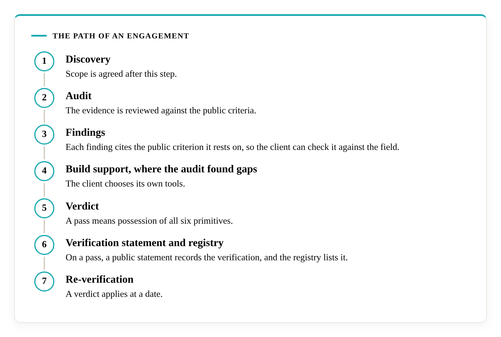
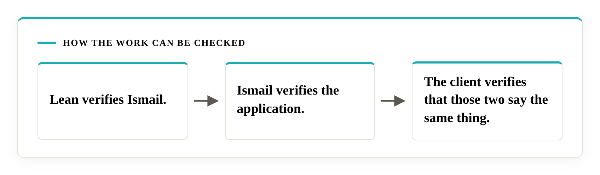

# How it works

Every proposal you are asked to approve is a decision, written down, and a decision has a structure behind it. Literacity audits that structure against six primitives that mathematics has proved necessary. You receive a finding for each, citing the public criterion it rests on, so you can check every finding yourself. When the structure passes, Literacity publishes a dated verification statement. This page sets out the path. Scope is set for each engagement after a discovery call.

In this repository the audit is the work, the verdict is its outcome, and the verification statement is the public record of a pass.

## Why the audit starts from a question

> What must a decision-maker get right, structurally, to avoid failure under uncertainty?

The [Dossier](https://decisional-integrity.github.io/Field/dossier/) documents a pattern of failures among major advisers and finds it predominantly structural. When the cause is structural, the useful question is the one above. Every organisation makes decisions through a structure: how it takes in information, chooses, commits, holds limits and revises its beliefs. The field defines [Decisional Integrity](https://decisional-integrity.github.io/Field/field/field-definition/) as the property a decision structure has when, in a Class C environment, it possesses all six primitives of [Ismail's Primitives](https://doi.org/10.5281/zenodo.23080967). Decisional Assurance is the act of verifying whether a structure has that property, and it is the service Literacity offers.

Where a primitive is missing, loss grows in proportion to time. That is the necessity result, and the [Lean 4 proof](https://github.com/M-Ismail-ZA/IsmailsPrimitives) is open for anyone to check. Every business decision area faces at least one of the six situations, and the [self-check](self-check.md) asks the six questions so you can see each one in your own decisions.

## What the audit rests on

The [paper](https://doi.org/10.5281/zenodo.23080967), the [Lean proof](https://github.com/M-Ismail-ZA/IsmailsPrimitives), the [field](https://decisional-integrity.github.io/Field/) and the [standard](https://decisional-integrity.github.io/Field/standard/standard/) with its criteria for each primitive are open to anyone. A client's audit, findings and evidence are visible to the client only.

The field's criteria are open. Carrying them out takes skill and a guidebook of Literacity's own. A verdict rests on the public criteria, so a client can check any finding against them without seeing anything Literacity holds privately.

## The path of an engagement

1. Discovery. Literacity learns the client's type and size, the decision processes in scope, the evidence available, and the confidentiality, access and disclosure terms that apply. A small business and a large corporation differ on each of these, so scope is agreed after this step. An engagement begins with a discovery call.
2. Audit. The evidence is reviewed against the public criteria. It comes from the client's decision records: past decisions with the evidence behind them, the framework currently in use, the decision process in effect, and the templates and procedures for new decisions. For an adviser, the past proposals to its own customers are part of that record. The cases examined are chosen by a rule fixed before the evidence is read, and the sample includes one case that succeeded, one that failed and one still in progress.
3. Findings. Each finding cites the public criterion it rests on, so the client can check it against the field. Findings are private to the client. The client can commission an independent evaluator, with access terms set after discovery.
4. Build support, where the audit found gaps. The client chooses its own tools. A spreadsheet and a customer-relationship system can both qualify. The test is whether the tool performs the function and produces the outcome the criteria describe.
5. Verdict. For each primitive, the verdict says whether a mechanism that performs the function exists and operates. It is dated, and the [certification terms](certification/terms.md) set out the sample and the version of the criteria it rests on. A pass means possession of all six primitives.
6. Verification statement and registry. On a pass, a public statement records the verification, and the [registry](certification/registry.md) lists it. A failed audit stays private. The statement and its terms are set out under [certification terms](certification/terms.md).
7. Re-verification. A verdict applies at a date. A material change in the verified structure ends the verification early, and a fresh check follows. After a first audit with one or more failures, the client can resubmit within six weeks. Details are on the terms page.

## The verification statement

The template reads as follows, with the bracketed fields filled in for each organisation verified.

> Ismail and Literacity verified that [Company] was evaluated on [date] and found to possess Ismail's Primitives in its decision structure. Evaluated against criteria version [x] on a sample of [y]. Valid for twelve months from [date].

The statement is a record of fact. It works as a two-way citation marker. Anyone may cite Ismail's Primitives under the CC BY 4.0 licence. The statement is a public record that the author checked the application. If an organisation says it uses Ismail's Primitives, the registry shows whether a verification exists, and Ismail can confirm or deny on enquiry.

## Who gives the verdict

The team at Literacity carries out the audit, and Ismail is the final arbiter of every verification at present. The field's [competence page](https://decisional-integrity.github.io/Field/field/competence/) states that the approving role is held on proof, in artefacts of a stated type and depth, whatever the person's credentials or affiliation. Another person who shows that proof can hold the role.

## What a verdict says

A verdict is a conformance finding on necessity. For each primitive it says whether a mechanism that performs the function exists and operates, at a stated date and on a stated sample, and it describes the structure as it stands at that date. The [certification terms](certification/terms.md) set out the terms, and the field's page on [necessity and sufficiency](https://decisional-integrity.github.io/Field/field/necessity-and-sufficiency/) explains why necessity is the floor under every sound decision.

## Checking the work

> Lean verifies Ismail. Ismail verifies the application. The client verifies that those two say the same thing.

Lean confirms that each proof follows from the stated definitions. You confirm that the definitions say what the claims say, and the field's [audit it yourself](https://decisional-integrity.github.io/Field/field/audit-it-yourself/) page shows where to read them. The field's page on [three-party verification](https://decisional-integrity.github.io/Field/field/three-party-verification/) explains each link. The check runs sideways, between Lean, Ismail and you, and [the Trace](the-trace.md) runs down from each finding to the axioms.

## Where to start

The [show-your-work self-check](self-check.md) lets an organisation see where its own records stand before any conversation, and [Choosing an adviser](choosing-an-adviser.md) puts the same questions to an adviser. To begin an engagement, write to [literacity@outlook.com](mailto:literacity@outlook.com) or through the [Literacity page on LinkedIn](https://www.linkedin.com/company/literacity-research/).
