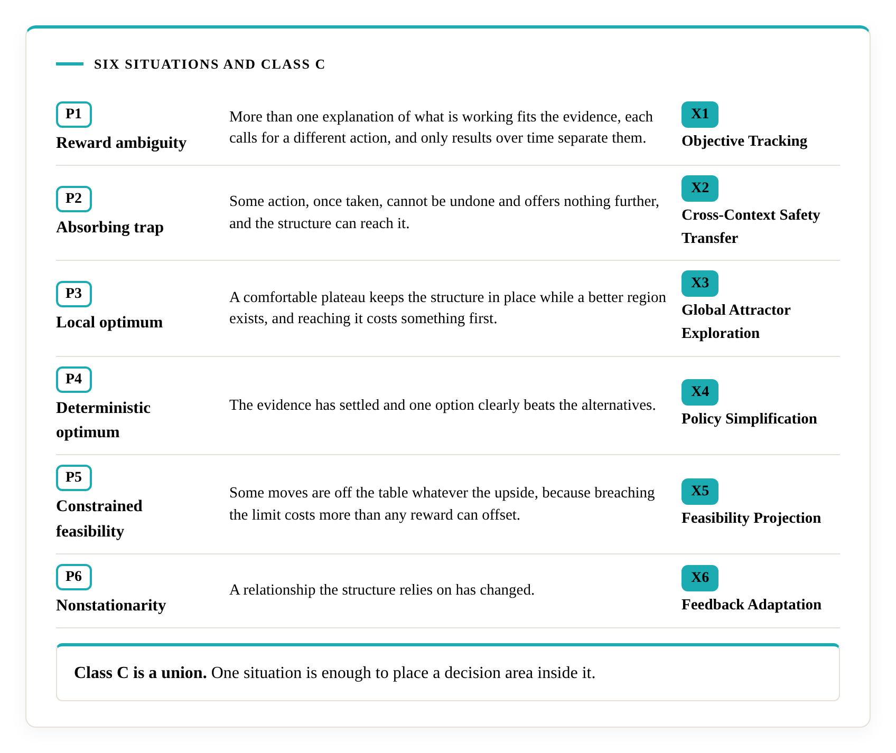

# Show-your-work self-check

Use these questions to find out where your organisation's decision records are strong and where you have none to show. For each of six capabilities, name the mechanism that performs it and point to one dated record where that mechanism changed a decision. The page collects nothing, and your answers stay with you. It prepares you for an audit. The same questions work on an adviser, and [Choosing an adviser](choosing-an-adviser.md) puts them that way.

The questions follow the field's published criteria for [X1](https://decisional-integrity.github.io/Field/standard/x1/), [X2](https://decisional-integrity.github.io/Field/standard/x2/), [X3](https://decisional-integrity.github.io/Field/standard/x3/), [X4](https://decisional-integrity.github.io/Field/standard/x4/), [X5](https://decisional-integrity.github.io/Field/standard/x5/) and [X6](https://decisional-integrity.github.io/Field/standard/x6/). Each criteria page states in full what counts as evidence. This page puts the shape of the question in plain terms, and each criteria page holds the full test.

## How to use it

Pick a decision your organisation makes repeatedly, such as pricing, hiring, investment, supplier choice or a product launch. Work through the sections below against that one decision area, and write each answer down with a date. Then repeat with a decision area from a different part of the organisation.

The field's general criteria ask for cases chosen by a rule fixed before the evidence is read. Apply that here. Choose one case that went well, one that went badly and one still under way, and answer from those.

## Step 1: which situations does the structure face?

The field's theory applies to a class of environments, Class C. An environment belongs to Class C when it shows at least one of six situations. A yes to any one places the decision area in Class C, and every business decision area has at least one. The field's [field definition](https://decisional-integrity.github.io/Field/field/field-definition/) page defines each situation, and its [Class C page](https://decisional-integrity.github.io/Field/field/class-c/) defines the class.

| Situation | Question to ask |
|---|---|
| P1 Reward ambiguity | Are there two explanations of what is working that would each call for a different action, where only results over time can separate them? |
| P2 Absorbing trap | Is there a kind of action that, once taken, leaves no way back and no further upside, and that you could reach from where you normally operate? |
| P3 Local optimum | Is there a comfortable plateau where small moves keep you in place, while a better region exists that costs something in the short term to reach? |
| P4 Deterministic optimum | Is there a recurring decision where one option beats the alternatives by a clear margin? |
| P5 Constrained feasibility | Is there a limit, such as a law, a safety rule or a capital floor, where a breach costs more than any reward elsewhere can offset? |
| P6 Nonstationarity | Has a relationship you rely on changed, in what an option pays or in how the situation moves? |

## Step 2: show your work for each primitive

For each primitive, name the mechanism and show one dated record. A mechanism can carry a different name from the primitive it serves. The test is the function. Under each primitive, "Look-alikes" lists the stand-ins most often offered in place of a mechanism.

### X1 Objective Tracking

The capability: telling apart two explanations that call for different actions.

- Name the mechanism. Where do you write down at least two explanations for the same results, each implying a different best action, and the observations that would separate them?
- Show one record. Point to a case where evidence arrived, the explanation you held changed, and the action changed with it.
- Look-alikes. Data collected with no competing explanations to test, a list of explanations that is never tested, and reports on which no decision followed.

### X2 Cross-Context Safety Transfer

The capability: keeping out of what the structure does the action that locks in permanent loss.

- Name the mechanism. Which specific actions or patterns cannot be undone and offer no further upside, and where is that account kept in front of the person deciding?
- Show one record. Point to a decision where one of those actions was available and was stopped or not taken, with the reason recorded.
- Look-alikes. "We do risk evaluation" with no named unrecoverable actions, a register that no decision has consulted, and a fall in incident counts that reflects fewer live cases while the rate among the remaining cases is unchanged.

### X3 Global Attractor Exploration

The capability: continuing to probe past a comfortable plateau toward a better region.

- Name the mechanism. Which standing, dated allocation of resources goes to moves that cost short-term results, with authority to accept that cost, and which better region is it aimed at?
- Show one record. Point to a move taken after performance had become good, with its short-term cost recognised in advance.
- Look-alikes. A one-off innovation project that ended, funding without authority to accept a short-term loss, and incremental improvement inside the current region.

### X4 Policy Simplification

The capability: committing once the evidence supports a single option.

- Name the mechanism. For a recurring decision, what is the stated point at which the evidence is treated as settled, and what is the rule for reopening it?
- Show one record. Point to a recurring decision where, after that point, resources and approvals consolidated on the supported option, with the evidence recorded and any reopening tied to new material evidence.
- Look-alikes. A decision announced as final while resources stay split across the alternatives it ruled out. Hedging while material evidence is still arriving is a different matter, because forcing commitment there would itself be the error.

### X5 Feasibility Projection

The capability: treating a hard constraint as a wall that cannot be traded off.

- Name the mechanism. Which limits are written down as non-tradeable, with what makes each one so, and how are options that breach them removed before alternatives are compared?
- Show one record. Point to an option that scored well on reward and was turned down for breaching a limit.
- Look-alikes. A compliance check that happens after the decision, a limit with a standing cost of crossing it or a routine waiver, and a soft preference labelled as a hard limit.

### X6 Feedback Adaptation

The capability: discarding evidence that went stale when the world changed.

- Name the mechanism. How is a change in the world noticed, which signals does it respond to, and what triggers a revisit of assumptions that rested on the old situation?
- Show one record. Point to a change that was noticed, the assumptions revised with dates, and later decisions that differ from earlier ones in the way the change required.
- Look-alikes. A review calendar with no trigger tied to change, a strategy refresh carried out as routine, and a reaction to a single outcome that is consistent with an unchanged process.

## Step 3: read your answers

Where you could name the mechanism and produce a dated record, you have evidence to show. Where you could name the mechanism and could not produce a record, the field's [general criteria](https://decisional-integrity.github.io/Field/standard/general-criteria/) treat the operation of a mechanism, shown in records of decisions, as the unit of evidence, so the next step is to find or create the record. A document, a method or a role becomes evidence when records show it operating. Where you could do neither, no mechanism has been shown yet, and that is where build support starts.

For each record you can show, a second pass asks four more questions. Does the mechanism operate across the whole organisation, including units beyond the one where it began? Has it been revised when circumstances changed, with dated revisions? Does it treat the same situation the same way each time? Do the records link the evidence the mechanism used to the decision it informed?

An audit reads the records themselves, across more than one case and from more than one party's account. Your answers prepare you for it. A verdict follows an audit, at a stated date, on a stated sample, against a stated version of the criteria. The path is on the [how-it-works page](how-it-works.md). The same six questions, turned onto a document, make up the proposal check on [Choosing an adviser, and checking a proposal](choosing-an-adviser.md).

## Where to go next

The field's [field definition](https://decisional-integrity.github.io/Field/field/field-definition/) page explains the terms. To begin an engagement, which starts with a discovery call, write to [literacity@outlook.com](mailto:literacity@outlook.com) or through the [Literacity page on LinkedIn](https://www.linkedin.com/company/literacity-research/).
