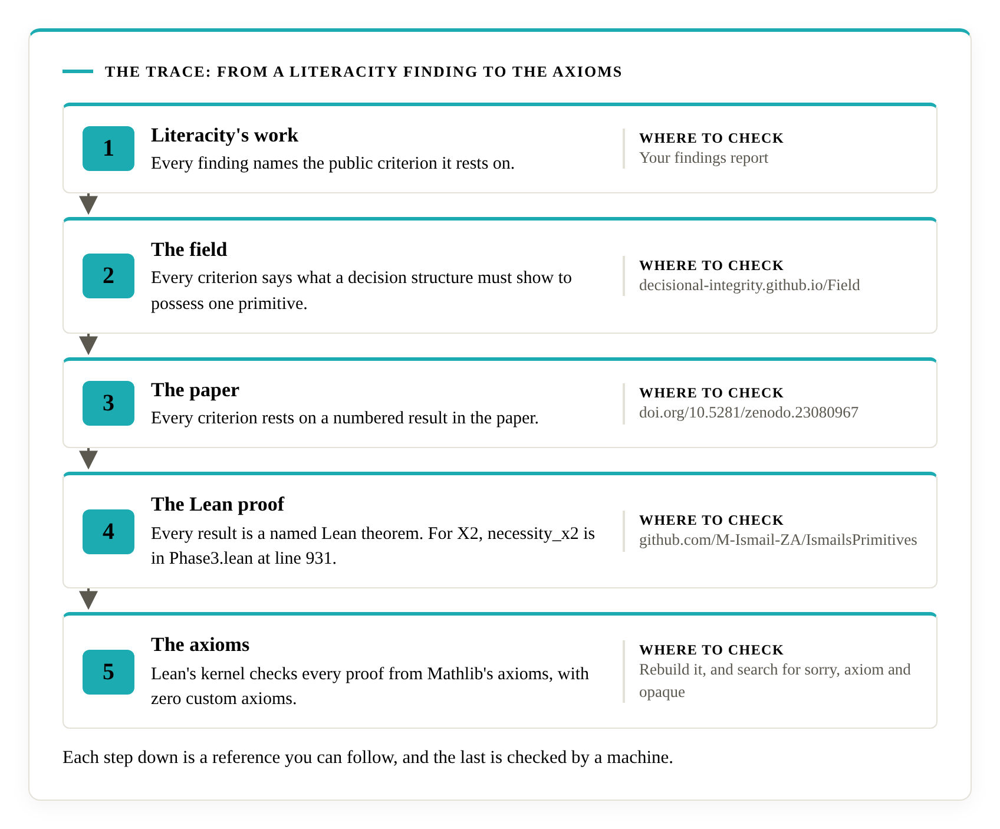

# The Trace

Every Literacity finding can be followed, one reference at a time, down to the axioms. The chain has five steps, and each step names where to check it.

## The five steps

1. **Literacity's work.** Every finding names the public criterion it rests on. The findings report is private to you.
2. **The field.** Each criterion on the field's [standard pages](https://decisional-integrity.github.io/Field/standard/standard/) says what a decision structure must show to possess one primitive, and names the Lean definitions it rests on.
3. **The paper.** The criteria rest on numbered results in the [paper](https://doi.org/10.5281/zenodo.23080967), and the paper's appendix maps each result to a Lean identifier.
4. **The Lean proof.** Each result is a named theorem in the [Lean repository](https://github.com/M-Ismail-ZA/IsmailsPrimitives), with a file and a line.
5. **The axioms.** Lean's kernel checks every step. The proof assumes nothing beyond Mathlib's axioms, and the repository holds zero custom `axiom`, zero `sorry` and zero `opaque` definitions.

## One finding, followed down

Take X2, which asks a structure to keep the action that cannot be undone out of its decisions.

| Step | What you find there |
|---|---|
| Finding | The audit's finding on X2, citing the field's X2 criteria |
| Field | The [X2 criteria](https://decisional-integrity.github.io/Field/standard/x2/): a mechanism that identifies permanent actions and keeps them out of decisions, with records of cases where one was declined |
| Paper | The corridor-and-trap environment and the X2 necessity result |
| Lean | `LacksX₂` at `SixPrimitives/Phase0.lean`, line 74, and `necessity_x2` at `SixPrimitives/Phase3.lean`, line 931 |
| Axioms | Checked by the kernel, from Mathlib's axioms alone |

The other five primitives follow the same pattern.

| Primitive | Necessity theorem | Location |
|---|---|---|
| X1 Objective Tracking | `necessity_x1` | `Phase3.lean`, line 122 |
| X2 Cross-Context Safety Transfer | `necessity_x2` | `Phase3.lean`, line 931 |
| X3 Global Attractor Exploration | `necessity_x3` | `Phase3.lean`, line 1556 |
| X4 Policy Simplification | `necessity_x4` | `Phase3.lean`, line 1831 |
| X5 Feasibility Projection | `necessity_x5` | `Phase3.lean`, line 2046 |
| X6 Feedback Adaptation | `necessity_x6` | `Phase3.lean`, line 2575 |

All thirty independence results follow from `mutual_independence` at `Phase4.lean`, line 1480.

## Following a finding

Pick any finding and walk it down. The finding names its criterion, the criterion names its Lean definitions, the definitions sit under a numbered result in the paper, and the result is a named theorem with a file and a line. Lean's kernel checks the theorem from Mathlib's axioms. The [three-party check](how-it-works.md) runs sideways, between Lean, Ismail and you. The Trace runs down, from the work to the axioms.

## Check it yourself

Run these from the root of the Lean repository.

1. `wc -l SixPrimitives/*.lean` totals 12,667 lines across seven files as of 2026-10-24.
2. `grep -rnw -e sorry -e axiom -e opaque SixPrimitives/` prints nothing.
3. `grep -rn "set_option" SixPrimitives/` prints one line, in `Phase2.lean`, which raises an instance-search time limit.

Then read the theorem statements and the definitions they rest on. The field's [audit it yourself](https://decisional-integrity.github.io/Field/field/audit-it-yourself/) page shows where to read them.
