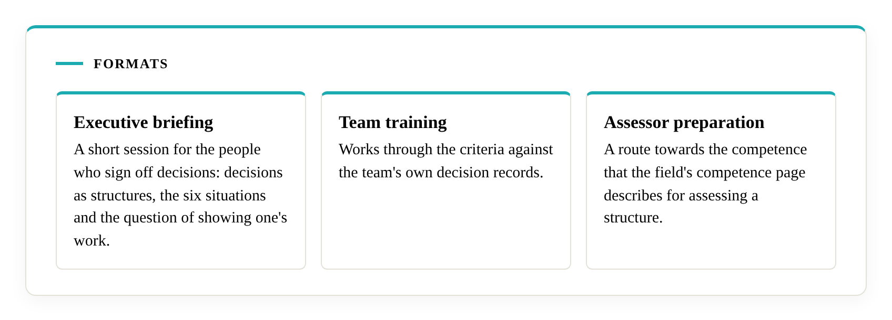

# Training

Training teaches the open criteria and the logic of the mathematics, so that you and your people can evaluate your own systems through the lens of Ismail's Primitives. It draws on the field's published criteria and pages.

## What it covers

Participants learn what the six situations and the six primitives mean in plain terms and how the [necessity and independence results](https://decisional-integrity.github.io/Field/field/necessity-and-sufficiency/) fit together. They practise telling a mechanism from an artefact in decision records, using the field's [general criteria](https://decisional-integrity.github.io/Field/standard/general-criteria/) and the criteria page for each primitive. They also learn the assessment errors that the field's [error theory](https://decisional-integrity.github.io/Field/field/error-theory/) names, and how to avoid them.

## Formats

An executive briefing is a short session for the people who sign off decisions: decisions as structures, the six situations and the question of showing one's work. Team training works through the criteria against the team's own decision records. Assessor preparation is a route towards the competence that the field's [competence page](https://decisional-integrity.github.io/Field/field/competence/) describes for assessing a structure.

## Candidates and roles

A person who completes assessor preparation is a candidate. The competence page states that the assessing, approving and evaluating roles are held on proof, in public artefacts of a stated type and depth. Assessor preparation prepares a candidate to build that proof. The field calls the combination uncommon: each discipline is taught and published, and what is rare is holding them together. At present Ismail is the final arbiter of every verification.

## Before training

The [show-your-work self-check](self-check.md) is a way to see where an organisation's own records stand. Training and every other service begin with a discovery call. Write to [literacity@outlook.com](mailto:literacity@outlook.com) or through the [Literacity page on LinkedIn](https://www.linkedin.com/company/literacity-research/).
