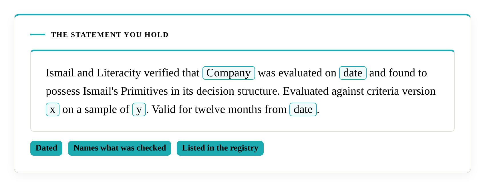
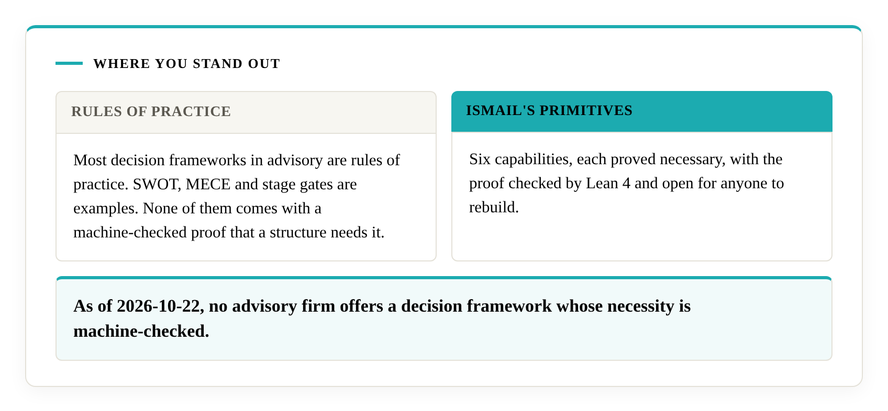
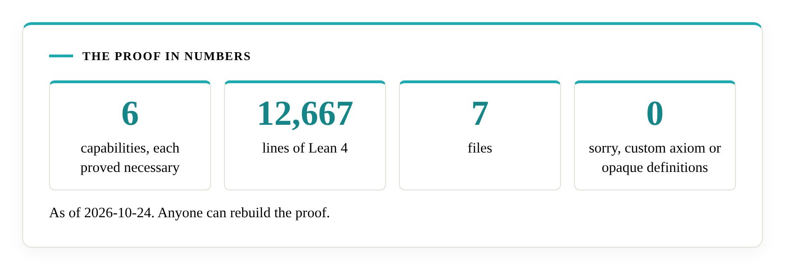
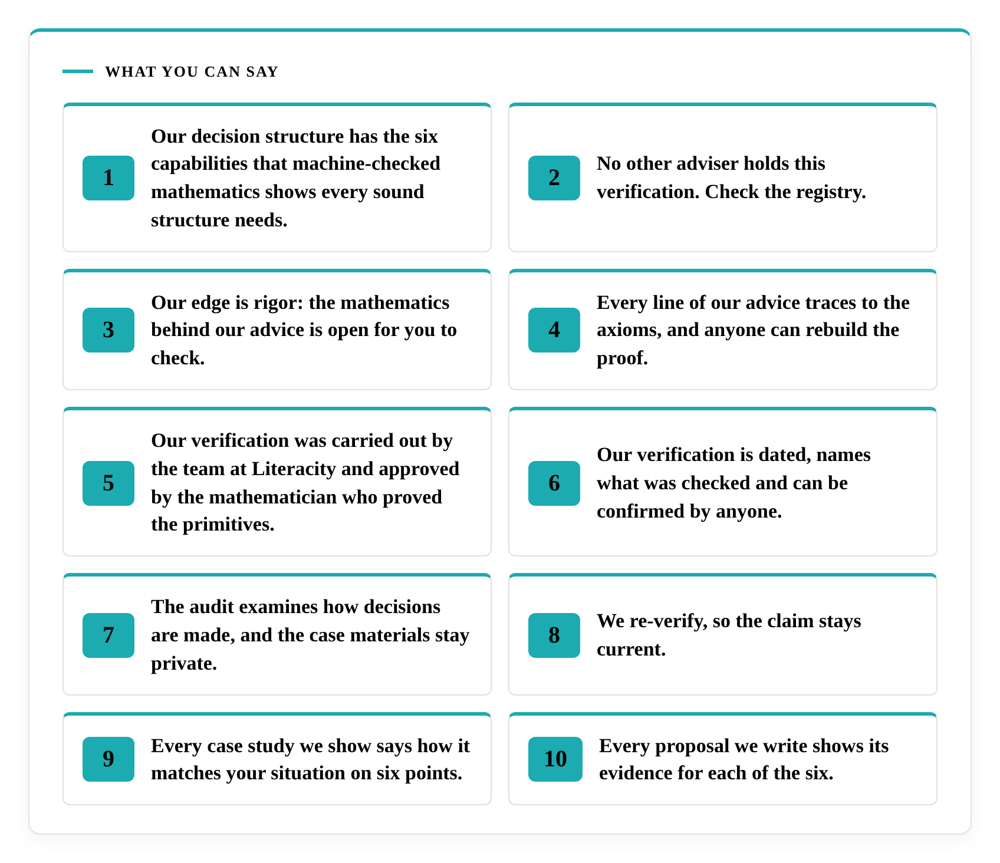

# What's in it for you

When the work is done, you hold something no other firm in your market can show today: a dated statement that your decision structure has the six capabilities that mathematics has proved every sound structure needs, backed by a proof you can point any sceptic to. This page sets out ten lines you can say with it and what stands behind each one. Each line rests on a public artefact, so each holds when someone checks it.

## Where you stand out

Most decision frameworks in advisory are rules of practice. SWOT, MECE and stage gates are examples. None of them comes with a machine-checked proof that a structure needs it. As of 2026-10-22, no advisory firm offers a decision framework whose necessity is machine-checked. Ismail checked for one, and a public search on the same date found none. Ismail's Primitives is such a framework: six capabilities, each proved necessary, with the proof checked by Lean 4 and open for anyone to rebuild.

The proof runs to 12,667 lines of Lean 4 in seven files, with zero `sorry`, zero custom `axiom` and zero `opaque` definitions as of 2026-10-24.

A firm that works with Literacity and passes the audit can say so about its own structure. In a market where the usual offer is "trust our experience", a verified firm offers a proof to read.

## What you can say

Ten lines, each with the evidence behind it.

| Say | What stands behind it |
|---|---|
| Our decision structure has the six capabilities that machine-checked mathematics shows every sound structure needs. | The dated verification statement, and the [proof](https://github.com/M-Ismail-ZA/IsmailsPrimitives) that Lean 4 checks. |
| No other adviser holds this verification. Check the registry. | The public [registry](certification/registry.md), which lists every verification issued. |
| Our edge is rigor: the mathematics behind our advice is open for you to check. | The open paper, proof and criteria, and a verdict reached against published criteria. |
| Every line of our advice traces to the axioms, and anyone can rebuild the proof. | [The Trace](the-trace.md), and the public [Lean repository](https://github.com/M-Ismail-ZA/IsmailsPrimitives), with 12,667 lines in seven files and zero `sorry`, custom `axiom` or `opaque` definitions as of 2026-10-24. |
| Our verification was carried out by the team at Literacity and approved by the mathematician who proved the primitives. | The statement itself, and the field's record of how the approver role is held: on proof, with public artefacts, Ismail's own included. |
| Our verification is dated, names what was checked and can be confirmed by anyone. | The statement records the date, what was checked, the criteria version and the sample, and the registry lists it. |
| The audit examines how decisions are made, and the case materials stay private. | The [terms page](certification/terms.md): case materials stay private, and only the fact and date of a pass are public. |
| We re-verify, so the claim stays current. | The twelve-month term and the re-verification rule on the [terms page](certification/terms.md). |
| Every case study we show says how it matches your situation on six points. | The six-point test in [Choosing an adviser, and checking a proposal](choosing-an-adviser.md). |
| Every proposal we write shows its evidence for each of the six. | The public proposal check. For a verified adviser, past proposals are part of the audit's sample. |

If you advise others, all ten lines serve you. If you run an organisation and want to show your board, lenders or partners how you decide, the first eight lines apply.

## Three lines ready to use

A headline: *Our decision structure has the six capabilities that machine-checked mathematics shows every sound structure needs.*

A line for a proposal: *Our decision structure was verified on [date] against the published criteria for Ismail's Primitives, and every proposal we write shows its evidence for each of the six.*

A line for a board paper or partner brief: *The verification is dated, names what was checked and is listed in the public registry, so you can confirm it without asking us.*

The bracketed date is a template field to fill from your own statement.

## The edge is rigor

Your clients and partners have heard "trust us" many times. You can say "check the mathematics". The paper, the Lean proof and the criteria are open, and the field's [audit it yourself](https://decisional-integrity.github.io/Field/field/audit-it-yourself/) page shows where to read what Lean checked. Lean confirms that each proof follows from its definitions. Ismail's verification confirms that your structure applies them correctly. Your reader confirms that the two say the same thing.

## Using the statement

Quote the statement as it is written. It names the decision areas and the sample, it is valid for twelve months, and a fresh check renews it after that or after a material change. The registry shows who holds a verification, so it answers any question about a competitor.

## What you gain along the way

The audit gives you a finding for each of the six, citing the public criterion, and the findings are private to you. Where the audit finds a gap, build support closes it with the tools you choose. Training teaches your people to evaluate their own systems against the same criteria. The [how-it-works](how-it-works.md) page sets out the path, and an engagement begins with a discovery call.
