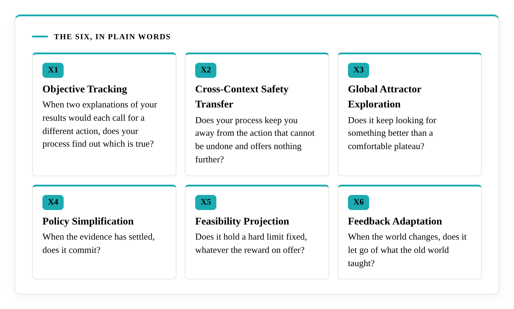
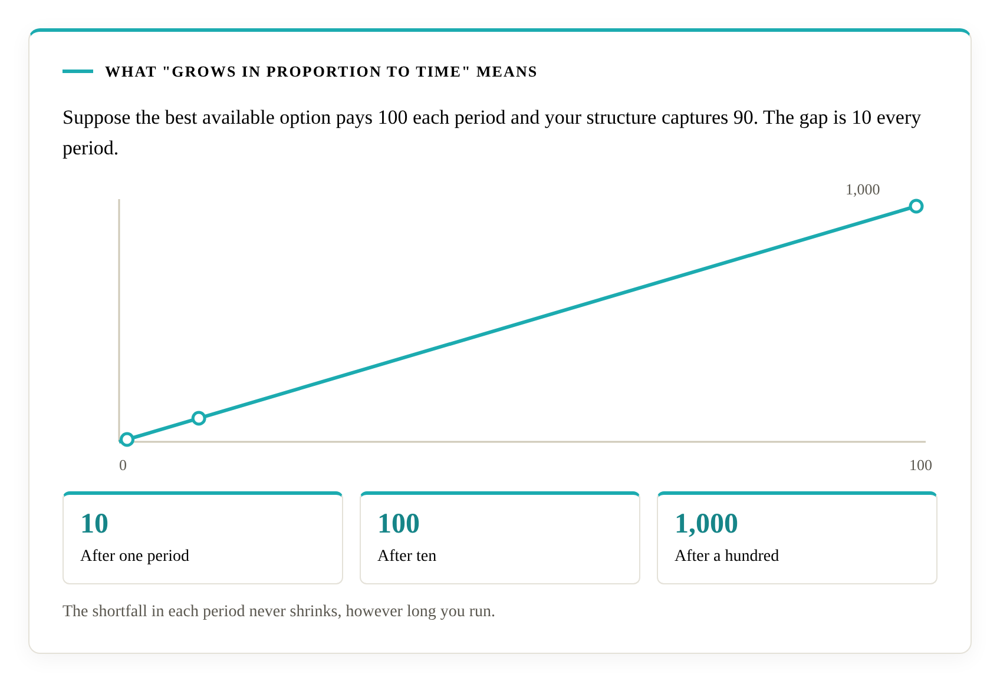
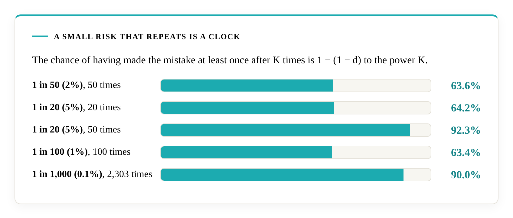

# Why the primitives matter

A decision structure is the standing arrangement that produces an organisation's decisions: how it takes in information, chooses, commits, holds limits and revises what it believes. Ismail's Primitives proves six things that arrangement needs. This page explains, without mathematics, what that means for the person who signs the decision.

## The six, in plain words

| Capability | The question it answers |
|---|---|
| Objective Tracking (X1) | When two explanations of your results would each call for a different action, does your process find out which is true? |
| Cross-Context Safety Transfer (X2) | Does your process keep you away from the action that cannot be undone and offers nothing further? |
| Global Attractor Exploration (X3) | Does it keep looking for something better than a comfortable plateau? |
| Policy Simplification (X4) | When the evidence has settled, does it commit? |
| Feasibility Projection (X5) | Does it hold a hard limit fixed, whatever the reward on offer? |
| Feedback Adaptation (X6) | When the world changes, does it let go of what the old world taught? |

## Failure has one shape

Success has no single shape. It depends on the market, the goal and a thousand choices. Failure has one shape. Where the matching capability is missing, the outcome is loss that grows in proportion to time, whatever else the structure does well and however success is defined. Lean 4 checks the proof, and anyone can rebuild it.

## What "grows in proportion to time" means

Suppose the best available option pays 100 each period and your structure captures 90. The gap is 10 every period. After ten periods it is 100. After a hundred it is 1,000. The shortfall in each period never shrinks, however long you run. The paper calls this linear regret.

## A good year can hide the gap

A process that lacks a required capability can post steady, positive results for a long time while the gap grows underneath. In the proof for X2, each step before the trap closes pays as normal. In the proof for X6, an out-of-date strategy keeps earning a return, only a smaller one than the best available.

## A small risk that repeats is a clock

Take the one mistake that cannot be undone. Suppose each time you face it there is a small chance, d, of making it. The chance of having made the mistake at least once after K times is 1 − (1 − d) to the power K.

| Chance each time | Number of times | Chance of having made it at least once |
|---|---:|---:|
| 1 in 50 (2%) | 50 | 63.6% |
| 1 in 20 (5%) | 20 | 64.2% |
| 1 in 20 (5%) | 50 | 92.3% |
| 1 in 100 (1%) | 100 | 63.4% |
| 1 in 1,000 (0.1%) | 2,303 | 90.0% |

These figures show why a rate that feels like a rounding error on one decision is a clock across many.

## Every business is in Class C

The theory covers environments where at least one of six situations arises, and every business decision area meets at least one, because of what business is. Information is incomplete. Commitments are often irreversible. Options can be comfortable without being best. Some limits cannot be traded. Markets change. Any one is enough. Renaming a trap does not make it reversible. The [self-check](self-check.md) asks six questions so that you can see each situation in your own decisions.

## What this means for a proposal

A proposal is a consolidated decision. It packages a choice, the evidence behind it and the plan to carry it out, and the plan is a structure that commits you to a course. That structure has all six primitives or lacks at least one. A plan that lacks one will fail in the way the proof defines. An audit shows which the plan is. A proposal that shows no evidence of the six leaves you unable to tell, and approving it means approving on trust. [Choosing an adviser, and checking a proposal](choosing-an-adviser.md) gives the six questions to put to any proposal.

## Two kinds of evidence

The proof is the formal evidence. It shows what any decision structure needs, and anyone can rebuild and check it. The [Dossier](https://decisional-integrity.github.io/Field/dossier/) is evidence of a different kind: a synthesis of 26 independence-rated reports that reads the failures it records as predominantly structural. One is mathematics and the other is the public record, and each can be checked without trusting Ismail or Literacity.

## What possession gives you

Possession of all six is necessary. It is the floor under every sound decision, and your strategy is what you build on it. Sufficiency work is planned from Q4 2027, and the [FAQ](about/faqs.md) gives the detail.
