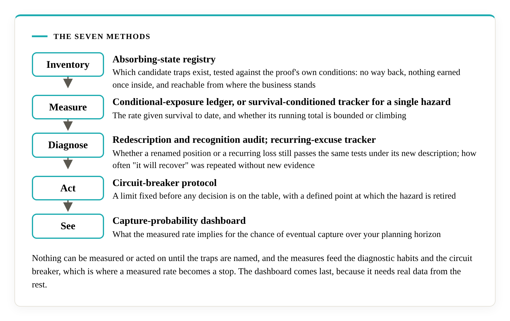

# Why Literacity

## Built by the author

Literacity was founded in 2016 and is owned and directed by Muhammed Ismail, who discovered and proved Ismail's Primitives. Literacity is a team: the team carries out every audit, its work rests on his research from start to finish, he trains it in that research, and he is the final arbiter of every verification. The work traces to the public field, the field to the mathematics, and the mathematics to the axioms, as the [Trace](the-trace.md) shows. As of 2026-10-22, Literacity is the only firm that applies the primitives: Ismail checked for any other firm applying them, explicitly or implicitly, and a public search on the same date found none. This line will change if that does.

## Advising on this takes a combination that is uncommon

You can read all of it. The paper, the proof, the field and the criteria are open. Applying them to a real decision structure takes a combination of disciplines, and the field's [competence page](https://decisional-integrity.github.io/Field/field/competence/) lists them. At an advanced level: formal verification in Lean 4 and Mathlib, lower-bound theory for sequential decisions, measure-theoretic probability, information theory, and the construction of new arguments. At a distinctive level: translating the framework into a domain, designing a research programme with explicit dependencies, keeping what is proved apart from what is argued, and writing evaluation protocols. Alongside them, knowledge of the setting assessed. The field calls the combination uncommon: each discipline is taught and published, and what is rare is having all of them.

The field assesses the combination by public, dated, reproducible artefacts, whatever the person's credentials or affiliation. Ismail has presented that proof.

## Familiar methods supply part of the six

SWOT, OODA, MECE, stage gates, pre-mortems, RAID logs, Monte Carlo simulation, scenario planning, Six Sigma and Agile each supply some of the six primitives. None supplies all six on its own. A method named in an organisation's practice is a lead to investigate. Evidence of possession is a record that shows the mechanism operating, because a template filled in once and filed performs no function. The [methodologies page](https://decisional-integrity.github.io/Field/field/methodologies/) sets out the mapping.

## Inside one primitive: X2

X2 reads like a single instruction: keep the action you cannot take back out of what the structure does. Putting that into practice takes seven distinct methods, and the mathematics decides what each one has to do. This is a snapshot of one primitive from Literacity's business guide, written by Ismail, which has a part of this kind for each of the six.

### Why it is harder than it reads

Three results from the proof shape the work.

The number that matters is the rate at which something goes wrong given that it has not gone wrong yet. The historical average improves with every quiet period, because the cases that were caught have already left the sample, so a falling average can sit beside a rate that is not falling at all.

Renaming a trap leaves it a trap. A position relabelled as a high-conviction bet still faces the same questions: is there a way back, does it pay anything once entered, and can the business reach it from where it stands today. The proof reads the structure and ignores the label.

A small rate that persists compounds. At 5% per period, the chance of having been caught at least once is about two in three after twenty periods. Judgment alone seldom brings such a rate to zero. A mechanism that removes the discretion can.

### The seven methods

| Job | Method | What it settles |
|---|---|---|
| Inventory | Absorbing-state registry | Which candidate traps exist, tested against the proof's own conditions: no way back, nothing earned once inside, and reachable from where the business stands |
| Measure | Conditional-exposure ledger, or survival-conditioned tracker for a single hazard | The rate given survival to date, and whether its running total is bounded or climbing |
| Diagnose | Redescription and recognition audit | Whether a renamed position or a recurring loss still passes the same tests under its new description |
| Diagnose | Recurring-excuse tracker | How often "it will recover" was repeated without new evidence |
| Act | Circuit-breaker protocol | A limit fixed before any decision is on the table, with a defined point at which the hazard is retired |
| See | Capture-probability dashboard | What the measured rate implies for the chance of eventual capture over your planning horizon |

The order matters. Nothing can be measured or acted on until the traps are named, and the measures feed the diagnostic habits and the circuit breaker, which is where a measured rate becomes a stop. The dashboard comes last, because it needs real data from the rest.

Each method answers to a named result in the proof, so a reader can trace it. The X2 necessity theorem and its failure condition are public in the [Lean repository](https://github.com/M-Ismail-ZA/IsmailsPrimitives). What stays with Literacity is the working detail: the structure of each record, the thresholds, the warning signs and the way the seven are fitted to a particular organisation.

### The other five

The other five primitives each carry a part of the same kind, with a method set of their own and the same build: what the primitive means in business terms, the structural test that separates a real instance from a look-alike, the proof, and methods tied to named results. X1, X4, X5 and X6 have five methods each and X3 has eight. An engagement applies the set for each primitive to the needs of the organisation being diagnosed, evaluated and improved.

## The roles are open

At present the final arbiter is the author, because he did the work the team builds on. Nobody is shut out. The competence page says any person can step into the approving role by presenting artefacts of the same type and depth. Ismail's own approval is held to that rule: it rests on public artefacts, listed on the field's [author page](https://decisional-integrity.github.io/Field/about/author/), that anyone can inspect. As of 2026-10-22 no one else has presented that proof, and when someone does, this page will say so.
